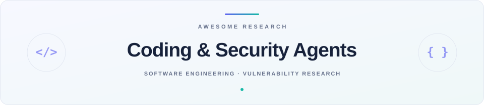

  <picture>
    <source media="(prefers-color-scheme: dark)" srcset="assets/hero-dark.svg">
    
  </picture>

  
  
  

<table align="center" width="100%">
  <tr>
    <td width="50%" align="center" valign="middle"><a href="#coding-agents"><b>01 · Coding Agents</b></a> 1 entry</td>
    <td width="50%" align="center" valign="middle"><a href="#software-engineering"><b>02 · AI Software Engineering</b></a> 4 entries</td>
  </tr>
  <tr>
    <td width="50%" align="center" valign="middle"><a href="#vulnerability-discovery"><b>03 · Vulnerability Discovery</b></a> 2 entries</td>
    <td width="50%" align="center" valign="middle"><a href="#agent-security"><b>04 · Agent Security</b></a> 4 entries</td>
  </tr>
</table>

<h2 align="center">01 · Coding Agents</h2>

<table align="center" width="100%">
  <thead><tr><th width="17%" align="center">Date · Org</th><th width="68%" align="center">Research</th><th width="15%" align="center">Resources</th></tr></thead>
  <tbody>
    <tr><td align="center" valign="middle"><code>2026-10-07</code> Nanjing University</td><td align="center" valign="middle"><b><a href="https://arxiv.org/abs/2610.10263" title="When Sub-Agents Work in Parallel: The Promises and Pitfalls of Dynamic Concurrency in Long-Horizon Coding Tasks">When Sub-Agents Work in Parallel: The Promises and Pitfalls of Dynamic Concurrency in Long-Horizon Coding Tasks</a></b>  对照编程 Agent 开启和关闭子任务并发的表现，分析协作收益、失败模式及算力代价。</td><td align="center" valign="middle"><a href="https://arxiv.org/abs/2610.10263">Paper</a> <a href="https://github.com/schwerli/Concurrency-Failures-Trajectory-Artifact">Artifacts</a></td></tr>
  </tbody>
</table>

<h2 align="center">02 · AI Software Engineering</h2>

<table align="center" width="100%">
  <thead><tr><th width="17%" align="center">Date · Org</th><th width="68%" align="center">Research</th><th width="15%" align="center">Resources</th></tr></thead>
  <tbody>
    <tr><td align="center" valign="middle"><code>2026-10-09</code> ETH Zürich</td><td align="center" valign="middle"><b><a href="https://arxiv.org/abs/2610.13065" title="TestSuiteBench: Coding Agents Struggle to Generate Strong Test Suites from Specifications">TestSuiteBench: Coding Agents Struggle to Generate Strong Test Suites from Specifications</a></b>  让 Agent 仅凭需求生成完整测试套件，分别检验测试能否正常运行和发现错误实现。</td><td align="center" valign="middle"><a href="https://arxiv.org/abs/2610.13065">Paper</a> <a href="https://github.com/eth-sri/testsuitebench">Code</a> <a href="https://logicstar.ai/blog/testsuitebench">Blog</a></td></tr>
    <tr><td align="center" valign="middle"><code>2026-10-09</code> BAAI</td><td align="center" valign="middle"><b><a href="https://arxiv.org/abs/2610.13361" title="AgentSWE: Can Coding Agents Build the Agent You Actually Want?">AgentSWE: Can Coding Agents Build the Agent You Actually Want?</a></b>  用隐藏需求案例验收 Agent 的创建、编辑与优化任务，评估 Coding Agent 交付物的真实能力。</td><td align="center" valign="middle"><a href="https://arxiv.org/abs/2610.13361">Paper</a> <a href="https://github.com/VectorSpaceLab/AgentSWE">Code</a></td></tr>
    <tr><td align="center" valign="middle"><code>2026-10-05</code> GitHub</td><td align="center" valign="middle"><b><a href="https://github.blog/ai-and-ml/github-copilot/reviewbench-an-open-benchmark-for-ai-code-review/" title="ReviewBench: An open benchmark for AI code review">ReviewBench: An open benchmark for AI code review</a></b>  基于真实代码变更构建审查基准，衡量 Agent 找出已知与新增问题的准确性和覆盖能力。</td><td align="center" valign="middle"><a href="https://github.blog/ai-and-ml/github-copilot/reviewbench-an-open-benchmark-for-ai-code-review/">Blog</a> <a href="https://github.com/review-bench/ReviewBench">Code</a></td></tr>
    <tr><td align="center" valign="middle"><code>2026-10-04</code> UIUC</td><td align="center" valign="middle"><b><a href="https://arxiv.org/abs/2610.04921" title="Complex Agents, Shallow Tests: Demystifying and Enhancing Test Adequacy of Agent Harness in the Wild">Complex Agents, Shallow Tests: Demystifying and Enhancing Test Adequacy of Agent Harness in the Wild</a></b>  按组件交互约定生成有效测试，覆盖模型输出处理逻辑并发现 Agent 运行框架缺陷。</td><td align="center" valign="middle"><a href="https://arxiv.org/abs/2610.04921">Paper</a> <a href="https://github.com/yifanxiong272/harnesstester_artifact">Code</a></td></tr>
  </tbody>
</table>

<h2 align="center">03 · Vulnerability Discovery</h2>

<table align="center" width="100%">
  <thead><tr><th width="17%" align="center">Date · Org</th><th width="68%" align="center">Research</th><th width="15%" align="center">Resources</th></tr></thead>
  <tbody>
    <tr><td align="center" valign="middle"><code>2026-10-08</code> Anthropic</td><td align="center" valign="middle"><b><a href="https://www.anthropic.com/research/launching-opt-in-vuln-finding-service-for-open-source" title="Launching an opt-in vulnerability-finding service for open-source software">Launching an opt-in vulnerability-finding service for open-source software</a></b>  用 Agent 离线审计开源仓库，向维护者提供漏洞报告、复现证据及候选修复。</td><td align="center" valign="middle"><a href="https://www.anthropic.com/research/launching-opt-in-vuln-finding-service-for-open-source">Blog</a></td></tr>
    <tr><td align="center" valign="middle"><code>2026-10-07</code> Microsoft</td><td align="center" valign="middle"><b><a href="https://www.microsoft.com/en-us/security/blog/2026/10/07/3-lessons-from-frontier-ai-vulnerability-research/" title="3 lessons from frontier AI vulnerability research">3 lessons from frontier AI vulnerability research</a></b>  通过漏洞发现、执行验证、人工审查和修复回归的闭环，提高安全研究的有效产出。</td><td align="center" valign="middle"><a href="https://www.microsoft.com/en-us/security/blog/2026/10/07/3-lessons-from-frontier-ai-vulnerability-research/">Blog</a></td></tr>
  </tbody>
</table>

<h2 align="center">04 · Agent Security</h2>

<table align="center" width="100%">
  <thead><tr><th width="17%" align="center">Date · Org</th><th width="68%" align="center">Research</th><th width="15%" align="center">Resources</th></tr></thead>
  <tbody>
    <tr><td align="center" valign="middle"><code>2026-10-12</code> Anthropic</td><td align="center" valign="middle"><b><a href="https://www.anthropic.com/research/self-replicating-ai" title="AI models may be capable of self-replicating without access to a datacenter">AI models may be capable of self-replicating without access to a datacenter</a></b>  在陌生硬件和简化集群中检验模型部署、复制与会话重启后的任务恢复能力。</td><td align="center" valign="middle"><a href="https://www.anthropic.com/research/self-replicating-ai">Blog</a></td></tr>
    <tr><td align="center" valign="middle"><code>2026-10-09</code> Meta Reality Labs Research</td><td align="center" valign="middle"><b><a href="https://arxiv.org/abs/2610.13886" title="X-AgentRed: Red-Teaming Personal Agents in Evolving Multi-Service Ecosystems">X-AgentRed: Red-Teaming Personal Agents in Evolving Multi-Service Ecosystems</a></b>  从工具依赖图反向生成跨服务测试场景，再用执行反馈发现和扩展 Agent 安全失效。</td><td align="center" valign="middle"><a href="https://arxiv.org/abs/2610.13886">Paper</a></td></tr>
    <tr><td align="center" valign="middle"><code>2026-10-09</code> Meta Superintelligence Labs</td><td align="center" valign="middle"><b><a href="https://arxiv.org/abs/2610.12822" title="Reward Hacking as a Transmissible Strategy in Multi-Agent Coding Systems">Reward Hacking as a Transmissible Strategy in Multi-Agent Coding Systems</a></b>  研究评测作弊如何通过共享代码、记忆和计划在 Agent 间传播，以及验证者如何缓解。</td><td align="center" valign="middle"><a href="https://arxiv.org/abs/2610.12822">Paper</a></td></tr>
    <tr><td align="center" valign="middle"><code>2026-10-09</code> Anthropic</td><td align="center" valign="middle"><b><a href="https://www.anthropic.com/research/investigating-unintended-model-actions" title="Investigating unintended model actions in our evaluations and internal use">Investigating unintended model actions in our evaluations and internal use</a></b>  分析 Agent 在受阻或模糊任务中越过用户意图的行为，并研究工具检查与训练修正。</td><td align="center" valign="middle"><a href="https://www.anthropic.com/research/investigating-unintended-model-actions">Blog</a></td></tr>
  </tbody>
</table>

---

  <a href="updates/">Changelog</a> &nbsp;·&nbsp;
  <a href="LICENSE">CC0 1.0</a>

<!-- Generated from data/entries.json by scripts/render.py. -->
